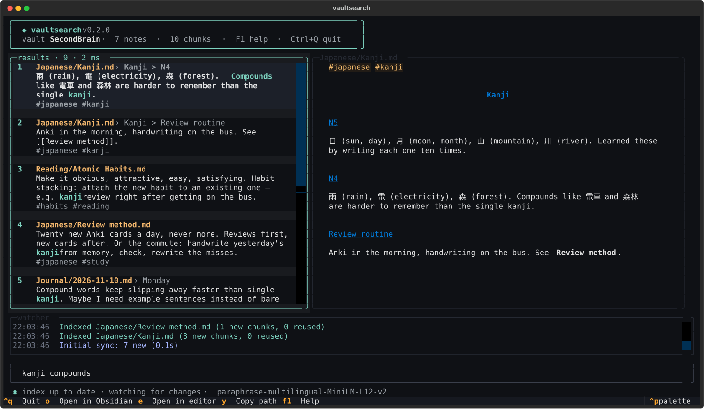
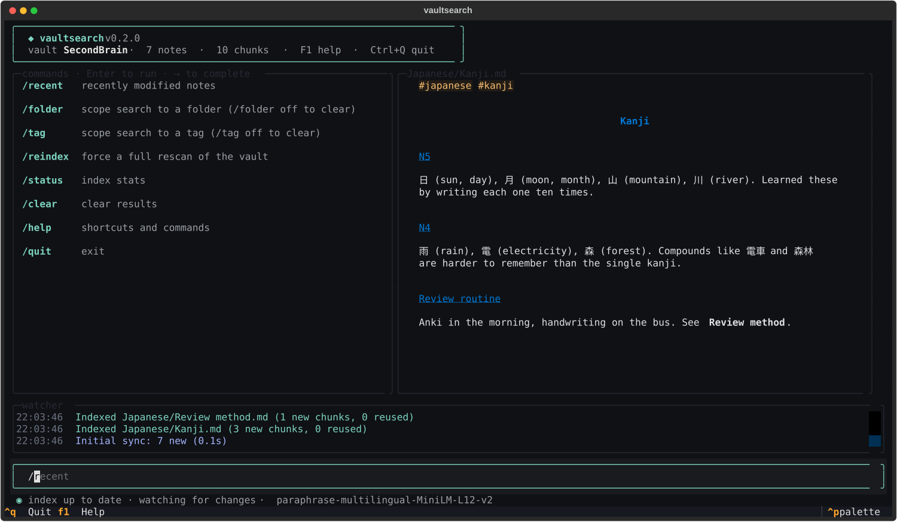

# VaultSearch

**A simple TUI to serach your Obsidian vaults.**

Instead of using an Obisidan plugin I wanted to have a more personalized experience; so I decided to create a simple TUI to search my own notes and continue to customize it as im using it.

The idea is to follow a RAG-like structure where the notes are indexed locally, keeps the index up to date while modifing the files, and gives you three ways to search:

- a **TUI** with live results and a note preview,
- a **CLI** for one-off searches and scripting (mostly for quick searches and debuggin, won't use it most likely)
- an **MCP server**, so Claude (or any MCP client) can search and read your notes for you.

Everything runs **locally**, at the moment I don't plan to implement any type of LLM content outside the MCP server. Since I can't reallly run a "real" LLM (at least 27b even with quantization); but can be a good implementation in the future.



---

## Example

Results update as you type. Each result shows the note, the section it came from and a snippet with your words highlighted. Move through them with the arrow keys and the preview on the right follows, scrolled to the matching section.

Press `Enter` and the note opens in Obsidian. Press `e` to open it in your editor instead (default for the terminal - *TBC*), or `y` to copy its path.

Every time you save a note in Obsidian, the *watcher* panel at the bottom shows it being re-indexed a couple of seconds later. You never have to index the vault yourself.

Type `/` for commands:



`/recent` lists what you touched lately. `/folder Japanese` or `/tag journal` narrows every search until you turn it off:


### Keys

| Key                       | What it does                              |
| ------------------------- | ----------------------------------------- |
| type                      | search (live)                             |
| `↓` / `Enter`        | jump from the prompt to the results       |
| `↑` `↓`             | move through results, the preview follows |
| `Enter`, `o` or click | open the note in Obsidian                 |
| `e`                     | open the note in your default editor      |
| `y`                     | copy the note's full path                 |
| `/` or `Esc`          | back to the prompt                        |
| `F1`                    | help                                      |
| `Ctrl+Q`                | quit                                      |

---

## Getting started

You need Python 3.10+ and [uv](https://docs.astral.sh/uv/) (`winget install astral-sh.uv` on Windows, `brew install uv` on macOS).

```bash
git clone https://github.com/pabloChantada/vault-search.git
cd vault-search
uv sync
uv run vaultsearch --vault "/path/to/your/vault"
```

The first run downloads the embedding model (about 220 MB, once) and indexes the whole vault. A few hundred notes take well under a minute on a CPU, **DISCLAIMER: I HAVEN'T TRIED IN A REALLY BIG VAULT, at the moment it works for my personal use. Can be optimized in the future**. After that, only notes that changed since last time are re-read.

To avoid typing `--vault` every time, set an environment variable:

```powershell
# Windows (then open a new terminal)
setx VAULT_PATH "path\to\vault"
```

```bash
# macOS / Linux
export VAULT_PATH="path\to\vault"
```

Now `uv run vaultsearch` makes it simpler.

---

## The CLI

For quick lookups or scripts, the same engine is available as commands:

```bash
vaultsearch index                      # update the index, with a progress bar and a summary
vaultsearch search "kanji compounds"   # print the top results
vaultsearch search "habits" --tag reading -n 5
vaultsearch status                     # index size and recently modified notes
vaultsearch watch                      # keep the index fresh in the background
```

`search` updates the index before searching (it's cheap), so results are never stale. Pass `--no-sync` to skip that step.

---

## Letting Claude read your notes (MCP)

`vaultsearch serve` starts an [MCP](https://modelcontextprotocol.io) server. Add it to Claude Desktop's config (`%APPDATA%\Claude\claude_desktop_config.json` on Windows, `~/Library/Application Support/Claude/claude_desktop_config.json` on macOS):

```json
{
  "mcpServers": {
    "vaultsearch": {
      "command": "uv",
      "args": ["--directory", "/path/to/vault-search", "run", "vaultsearch", "serve"],
      "env": { "VAULT_PATH": "/path/to/your/vault" }
    }
  }
}
```

Restart Claude Desktop and ask things like *"what did I write about kanji review last week?"*. Claude gets four tools:

| Tool                                          | What it's for                                       |
| --------------------------------------------- | --------------------------------------------------- |
| `search_vault(query, limit, folder?, tag?)` | hybrid search, optionally scoped to a folder or tag |
| `read_note(path)`                           | the full note, plus the notes that link to it       |
| `list_notes(folder?, limit)`                | most recently modified notes                        |
| `index_status()`                            | how many notes and chunks are indexed               |

While Claude Desktop is open, the server keeps watching your vault, just like the TUI does.

---

## How it works

```
Obsidian saves a note ─► watchdog ─► debounce (2 s)
                                        │
                                        ▼
                   split into chunks by heading and paragraph
                                        │  each chunk is hashed
                     ┌──────────────────┴──────────────────┐
              unchanged chunk                         new chunk
              (keeps its vector)              fastembed ─► vector
                     └──────────────────┬──────────────────┘
                                        ▼
        one SQLite file: notes · chunks · FTS5 keyword index · sqlite-vec vectors

query ─► BM25 keyword search  ┐
      └► vector similarity    ┴─► Reciprocal Rank Fusion ─► max 2 chunks per note
```

A few decisions worth explaining:

- **Hybrid search.** Embeddings find notes by meaning ("how was I studying" finds "review routine"), but they're bad at names and exact terms. BM25 is the opposite. Merging both rankings with Reciprocal Rank Fusion gets you the best of each, with no score tuning.
- **Incremental indexing.** Every chunk is hashed. Edit one paragraph and only that paragraph gets re-embedded. Renaming or moving a note re-embeds nothing.
- **The index lives outside the vault** (`~/.vaultsearch/`). If your vault syncs through iCloud or OneDrive, a database file inside it would get synced mid-write and eventually corrupted.
- **A safety-net rescan.** Cloud-synced folders don't always fire file events reliably, so the watcher also does a cheap full rescan every 10 minutes. It only compares modification times, so it costs almost nothing.
- **Local, multilingual embeddings.** The default model (`paraphrase-multilingual-MiniLM-L12-v2`, via ONNX) handles English, Spanish, Japanese and dozens more, runs on CPU and needs no API key.

---

## Configuration

| Variable              | Default                                   |                                                                                                                          |
| --------------------- | ----------------------------------------- | ------------------------------------------------------------------------------------------------------------------------ |
| `VAULT_PATH`        | —                                        | your vault (same as `--vault`)                                                                                         |
| `VAULTSEARCH_DB`    | `~/.vaultsearch/<vault>-<hash>.db`      | where the index lives                                                                                                    |
| `VAULTSEARCH_MODEL` | `paraphrase-multilingual-MiniLM-L12-v2` | any [fastembed text model](https://qdrant.github.io/fastembed/examples/Supported_Models/); changing it rebuilds the index |

## Development

```bash
uv sync --extra dev
uv run pytest
```

The tests use a tiny fake embedder, so they run offline in a few seconds. That includes one that drives the TUI headlessly.

## Known limitations

- **Keyword search and Japanese.** SQLite's tokenizer splits on spaces, and Japanese doesn't use them, so Japanese queries rely on the semantic side of the search. That works well, but exact-match keyword hits won't show up. A trigram index would fix it.
- **Opening notes in Obsidian** uses the `obsidian://` URL scheme, which needs the vault name in vaultsearch to match the one Obsidian knows.

## Ideas

- Boost results that are linked to other strong results (`[[links]]` as a ranking signal)
- Date filters for journal notes
- A cross-encoder reranker over the top 20
- Export the vectors for a 3D map of the vault
