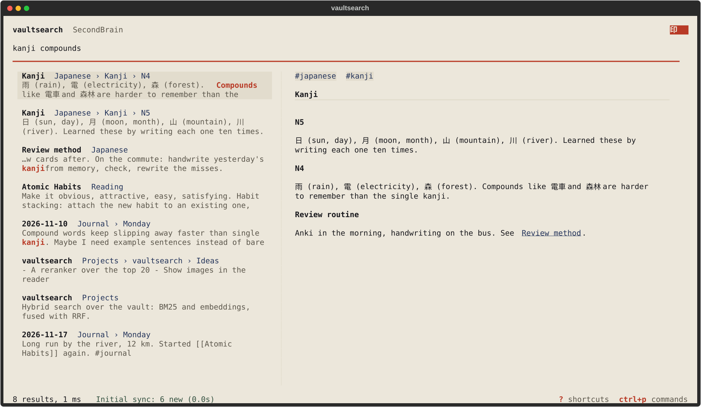
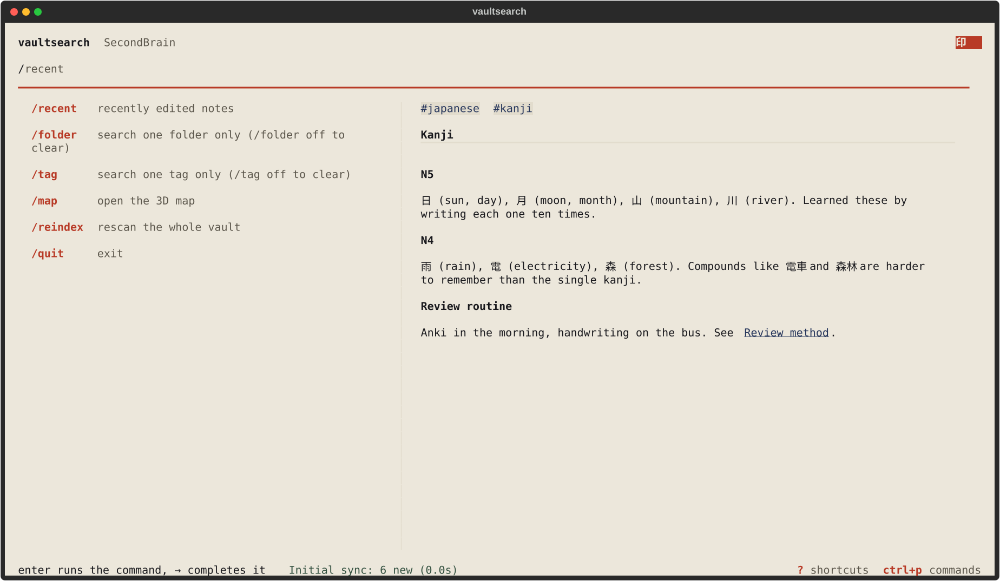
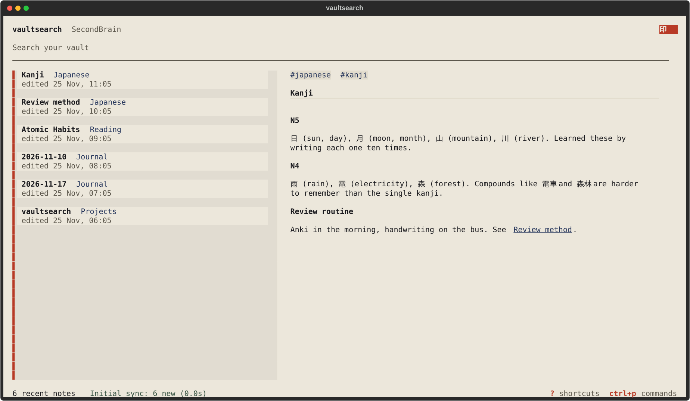

# VaultSearch

[](https://github.com/pabloChantada/vault-search/actions/workflows/ci.yml)

**A simple TUI to search your Obsidian vaults.**

Instead of using an Obsidian plugin I wanted to have a more personalized experience, so I decided to create a simple TUI to search my own notes and continue to customize it as I'm using it.

The idea is to follow a RAG-like structure where the notes are indexed locally, keeps the index up to date while modifying the files, and gives you three ways to search:

- a **TUI** with live results and a note preview,
- a **CLI** for one-off searches and scripting (mostly for quick searches and debugging, won't use it most likely)
- an **MCP server**, so Claude (or any MCP client) can search and read your notes for you.

It's built to be **fast**: a search takes ~6 ms, so results follow every keystroke, and the first results show up about a second and a half after launch ([numbers](docs/performance.md)).

Everything runs **locally**, at the moment I don't plan to implement any type of LLM content outside the MCP server. Since I can't really run a "real" LLM (at least 27b even with quantization); but can be a good implementation in the future.



---

## Example

The TUI wears the same ink-on-paper palette as the [vault map](#vault-map): washi paper, sumi ink, and one vermilion seal that marks where you are (the focused pane, the cursor, the words that matched). The seal in the top right corner turns grey while the index is being updated. `ctrl+p` → *Night colours* swaps to paper-on-ink for dark rooms.

Results update as you type. Each result shows the note, the folder and section it came from, and a line with your words in vermilion. Move through them with `j`/`k` (or the arrows) and the note on the right follows, scrolled to the matching section. Press `l` to step into the note and read it like a pager in Vim; `h` brings you back.

Press `Enter` and the note opens in Obsidian. Press `e` to open it in your editor instead (default for the terminal - *TBC*), or `y` to copy its path. `m` opens the 3D map in a window of its own.

Every time you save a note in Obsidian, the status line flashes it being re-indexed a couple of seconds later (`ctrl+p` → *Activity* shows the whole log). You never have to index the vault yourself.

`?` shows every key on one sheet. `ctrl+p` lists the commands, and the ones that need a word can also be typed with a `/`:



`/recent` lists what you touched lately. `/folder Japanese` or `/tag journal` narrows every search until you turn it off:



### Keys

| Where    | Key                     | What it does                          |
| -------- | ----------------------- | ------------------------------------- |
| search   | type                    | search as you go                      |
|          | `Enter` / `↓`           | go to the results                     |
| results  | `j` `k` / `↑` `↓`       | next, previous result (the note follows) |
|          | `l` / `Tab`             | read the note                         |
|          | `Enter`, `o` or click   | open in Obsidian                      |
|          | `e`                     | open in your default editor           |
|          | `y`                     | copy the note's full path             |
| note     | `j` `k`                 | scroll a line (the mouse wheel works too) |
|          | `Ctrl+D` `Ctrl+U`       | half a page down, up                  |
|          | `Space` `b`             | a page down, up                       |
|          | `g` `G`                 | top, bottom                           |
|          | `]` `[`                 | next, previous heading                |
|          | `h` / `Esc`             | back to the results                   |
| anywhere | `/` or `Esc`            | back to the search box                |
|          | `m`                     | open the 3D map                       |
|          | `Ctrl+P`                | commands                              |
|          | `?` / `F1`              | all the shortcuts                     |
|          | `Ctrl+Q`                | quit                                  |

---

## Getting started

You need Python 3.10+ and [uv](https://docs.astral.sh/uv/) (`winget install astral-sh.uv` on Windows, `brew install uv` on macOS).

```bash
git clone https://github.com/pabloChantada/vault-search.git
cd vault-search
uv sync
uv run vaultsearch --vault "/path/to/your/vault"
```

The first run downloads the embedding model (about 220 MB, once) and indexes the whole vault. A few hundred notes take about a minute and a half on a CPU (I haven't tried a really big vault yet). After that, only notes that changed since last time are re-read.

To avoid typing `--vault` every time, set an environment variable:

```powershell
# Windows (then open a new terminal)
setx VAULT_PATH "path\to\vault"
```

```bash
# macOS / Linux
export VAULT_PATH="path\to\vault"
```

Now `uv run vaultsearch` makes it simpler.

---

## The CLI

For quick lookups or scripts, the same engine is available as commands:

```bash
vaultsearch index                      # update the index, with a progress bar and a summary
vaultsearch search "kanji compounds"   # print the top results
vaultsearch search "habits" --tag reading -n 5
vaultsearch status                     # index size and recently modified notes
vaultsearch watch                      # keep the index fresh in the background
vaultsearch map --open                 # map of the vault in its own window
```

`search` updates the index before searching (it's cheap), so results are never stale. Pass `--no-sync` to skip that step.

### Vault map

`vaultsearch map --open` (or `m` in the TUI) draws your vault as a Chinese mountain-and-water landscape (山水), in a window of its own. Notes are placed by meaning, so each mountain is a cluster of related notes: the more notes a subject has, the higher it stands, and its peaks are your most-linked notes. Brush-drawn trails join clusters linked by `[[links]]`.

It has search (`/`), folder toggles, and a panel with each note's links and a button to open it in Obsidian. Install `uv sync --extra viz` for a UMAP layout (PCA otherwise) and `--extra window` for a native window. Without `--open`, `map` writes `vault-map.html` in the current folder.

---

## Letting Claude read your notes (MCP)

`vaultsearch serve` starts an [MCP](https://modelcontextprotocol.io) server. Add it to Claude Desktop's config (`%APPDATA%\Claude\claude_desktop_config.json` on Windows, `~/Library/Application Support/Claude/claude_desktop_config.json` on macOS):

```json
{
  "mcpServers": {
    "vaultsearch": {
      "command": "uv",
      "args": ["--directory", "/path/to/vault-search", "run", "vaultsearch", "serve"],
      "env": { "VAULT_PATH": "/path/to/your/vault" }
    }
  }
}
```

Restart Claude Desktop and ask things like *"what did I write about kanji review last week?"*. Claude gets four tools:

| Tool                                          | What it's for                                       |
| --------------------------------------------- | --------------------------------------------------- |
| `search_vault(query, limit, folder?, tag?)` | hybrid search, optionally scoped to a folder or tag |
| `read_note(path)`                           | the full note, plus the notes that link to it       |
| `list_notes(folder?, limit)`                | most recently modified notes                        |
| `index_status()`                            | how many notes and chunks are indexed               |

While Claude Desktop is open, the server keeps watching your vault, just like the TUI does.

---

## Configuration

| Variable              | Default                                   |                                                                                                                          |
| --------------------- | ----------------------------------------- | ------------------------------------------------------------------------------------------------------------------------ |
| `VAULT_PATH`        | —                                        | your vault (same as `--vault`)                                                                                         |
| `VAULTSEARCH_DB`    | `~/.vaultsearch/<vault>-<hash>.db`      | where the index lives                                                                                                    |
| `VAULTSEARCH_MODEL` | `paraphrase-multilingual-MiniLM-L12-v2` | any [fastembed text model](https://qdrant.github.io/fastembed/examples/Supported_Models/); changing it rebuilds the index |
| `VAULTSEARCH_EMBED_BATCH` | `8` | texts per ONNX run |
| `VAULTSEARCH_EMBED_THREADS` | onnxruntime default (physical cores) | ONNX threads; set it lower to leave CPU free while indexing |
| `VAULTSEARCH_INDEX_BATCH` | `256` | new chunks gathered across notes before embedding and writing them |

## Development

```bash
uv sync --extra dev
uv run pytest
```

The tests use a tiny fake embedder, so they run offline in a few seconds. That includes one that drives the TUI headlessly.

The technical details live in `docs/`:

- [Architecture](docs/architecture.md): how indexing, search, startup, the reader and the map work, and why.
- [Performance](docs/performance.md): the benchmark scripts and their results.

## Known limitations

- **Keyword search and Japanese.** SQLite's tokenizer splits on spaces, and Japanese doesn't use them, so Japanese queries rely on the semantic side of the search. That works well, but exact-match keyword hits won't show up. A trigram index would fix it.
- **Opening notes in Obsidian** uses the `obsidian://` URL scheme, which needs the vault name in vaultsearch to match the one Obsidian knows.

## Ideas

- Boost results that are linked to other strong results (`[[links]]` as a ranking signal)
- Date filters for journal notes
- A cross-encoder reranker over the top 20