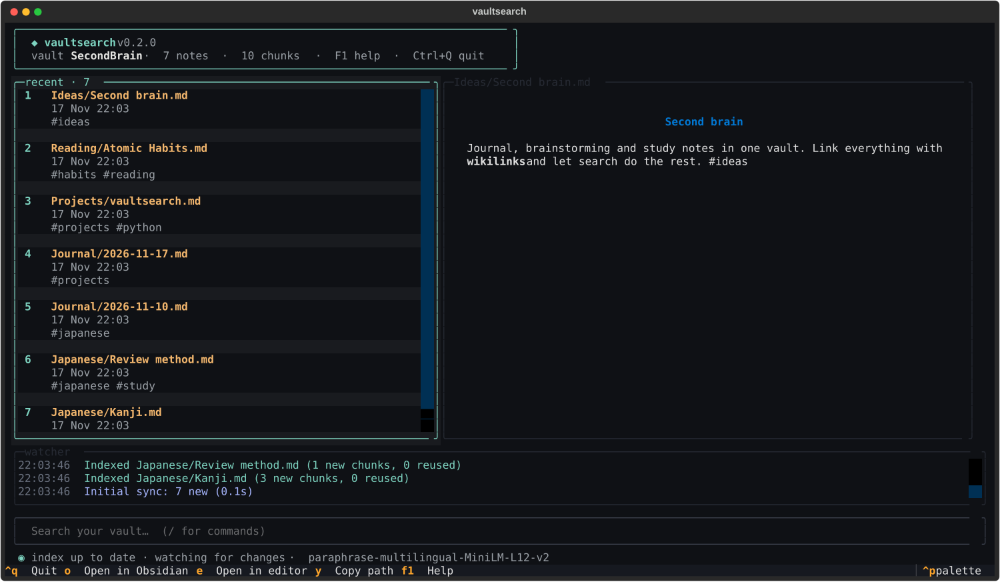

# VaultSearch

**A simple TUI to serach your Obsidian vaults.**

Instead of using an Obisidan plugin I wanted to have a more personalized experience; so I decided to create a simple TUI to search my own notes and continue to customize it as im using it.

The idea is to follow a RAG-like structure where the notes are indexed locally, keeps the index up to date while modifing the files, and gives you three ways to search:

- a **TUI** with live results and a note preview,
- a **CLI** for one-off searches and scripting (mostly for quick searches and debuggin, won't use it most likely)
- an **MCP server**, so Claude (or any MCP client) can search and read your notes for you.

Everything runs **locally**, at the moment I don't plan to implement any type of LLM content outside the MCP server. Since I can't reallly run a "real" LLM (at least 27b even with quantization); but can be a good implementation in the future.


---

## Example

The TUI wears the same ink-on-paper palette as the [vault map](#vault-map): washi paper, sumi ink, and one vermilion seal that marks where you are (the focused pane, the cursor, the words that matched). The seal in the top right corner turns grey while the index is being updated. `ctrl+p` → *Night colours* swaps to paper-on-ink for dark rooms.

Results update as you type. Each result shows the note, the folder and section it came from, and a line with your words in vermilion. Move through them with `j`/`k` (or the arrows) and the note on the right follows, scrolled to the matching section. Press `l` to step into the note and read it like a pager in Vim; `h` brings you back.

Press `Enter` and the note opens in Obsidian. Press `e` to open it in your editor instead (default for the terminal - *TBC*), or `y` to copy its path. `m` opens the 3D map in a window of its own.

Every time you save a note in Obsidian, the status line flashes it being re-indexed a couple of seconds later (`ctrl+p` → *Activity* shows the whole log). You never have to index the vault yourself.

`?` shows every key on one sheet. `ctrl+p` lists the commands, and the ones that need a word can also be typed with a `/`:


`/recent` lists what you touched lately. `/folder Japanese` or `/tag journal` narrows every search until you turn it off:



### Keys

| Where    | Key                     | What it does                          |
| -------- | ----------------------- | ------------------------------------- |
| search   | type                    | search as you go                      |
|          | `Enter` / `↓`           | go to the results                     |
| results  | `j` `k` / `↑` `↓`       | next, previous result (the note follows) |
|          | `l` / `Tab`             | read the note                         |
|          | `Enter`, `o` or click   | open in Obsidian                      |
|          | `e`                     | open in your default editor           |
|          | `y`                     | copy the note's full path             |
| note     | `j` `k`                 | scroll a line (the mouse wheel works too) |
|          | `Ctrl+D` `Ctrl+U`       | half a page down, up                  |
|          | `Space` `b`             | a page down, up                       |
|          | `g` `G`                 | top, bottom                           |
|          | `]` `[`                 | next, previous heading                |
|          | `h` / `Esc`             | back to the results                   |
| anywhere | `/` or `Esc`            | back to the search box                |
|          | `m`                     | open the 3D map                       |
|          | `Ctrl+P`                | commands                              |
|          | `?` / `F1`              | all the shortcuts                     |
|          | `Ctrl+Q`                | quit                                  |

---

## Getting started

You need Python 3.10+ and [uv](https://docs.astral.sh/uv/) (`winget install astral-sh.uv` on Windows, `brew install uv` on macOS).

```bash
git clone https://github.com/pabloChantada/vault-search.git
cd vault-search
uv sync
uv run vaultsearch --vault "/path/to/your/vault"
```

The first run downloads the embedding model (about 220 MB, once) and indexes the whole vault. A few hundred notes take well under a minute on a CPU, **DISCLAIMER: I HAVEN'T TRIED IN A REALLY BIG VAULT, at the moment it works for my personal use. Can be optimized in the future**. After that, only notes that changed since last time are re-read.

To avoid typing `--vault` every time, set an environment variable:

```powershell
# Windows (then open a new terminal)
setx VAULT_PATH "path\to\vault"
```

```bash
# macOS / Linux
export VAULT_PATH="path\to\vault"
```

Now `uv run vaultsearch` makes it simpler.

---

## The CLI

For quick lookups or scripts, the same engine is available as commands:

```bash
vaultsearch index                      # update the index, with a progress bar and a summary
vaultsearch search "kanji compounds"   # print the top results
vaultsearch search "habits" --tag reading -n 5
vaultsearch status                     # index size and recently modified notes
vaultsearch watch                      # keep the index fresh in the background
vaultsearch map --open                 # map of the vault in its own window (--theme sansui|yggdrasil)
```

`search` updates the index before searching (it's cheap), so results are never stale. Pass `--no-sync` to skip that step.

### Vault map

`vaultsearch map` writes a single HTML page (three.js, loaded from a CDN) that draws your vault. Notes are placed by meaning: each one is the mean of its chunk embeddings, projected with UMAP, so notes about similar things end up together. There are two themes:

- **`--theme sansui`** (default): the vault painted as a Chinese mountain-and-water landscape (山水). Each mountain is a cluster of related notes, laid out on a 2D UMAP of the embeddings: the more notes a subject has, the higher it stands, and its peaks are your most-linked notes. Mist separates near, middle and far ranges, and ink follows the form of the land (outlines heavier at the base, fine strokes down the slopes). Notes are moss dots, pale when you haven't touched them in a while. Brush-drawn trails join clusters linked by `[[links]]`. On first load the painting draws itself in about 7 seconds, in the order the notes were written. You can switch between four classic viewpoints, from above to a high-distance view. Selecting a note draws its links in vermilion.
- **`--theme yggdrasil`**: the vault as the world tree, with time running upward. The roots hold your oldest notes and the crown this month's. Each folder is a limb that leaves the trunk when you started it and forks into sub-limbs, one per cluster of related notes. Leaves turn autumnal when you stop editing them. Golden sap runs along your `[[links]]` through the trunk, and Ratatoskr, the messenger squirrel, carries it to each linked note when you select one.

Both have search (`/`), folder toggles, and a panel with the note's links and a button to open it in Obsidian. They respect `prefers-reduced-motion`. When a note was written comes from its frontmatter (`created`, `date`…), a `YYYY-MM-DD` in its title (daily notes), or the file's creation time, in that order.

The projection uses UMAP (cosine) when `umap-learn` is installed (`uv sync --extra viz`) and PCA otherwise. The map is an extra: nothing in it touches the indexer or the MCP server.

`m` in the TUI (or `map --open`) draws the map next to the index in `~/.vaultsearch/` and shows it in a window of its own: a Chromium browser in app mode (`--app`), with no tabs or address bar and its own small profile, so it doesn't land as a tab in your browser. Edge ships with Windows, so the window is always there; on macOS and Linux it uses Chrome, Chromium, Brave or Edge if one is installed, and falls back to your default browser if none is. Without `--open`, `map` writes `vault-map.html` in the current folder, as before.

---

## Letting Claude read your notes (MCP)

`vaultsearch serve` starts an [MCP](https://modelcontextprotocol.io) server. Add it to Claude Desktop's config (`%APPDATA%\Claude\claude_desktop_config.json` on Windows, `~/Library/Application Support/Claude/claude_desktop_config.json` on macOS):

```json
{
  "mcpServers": {
    "vaultsearch": {
      "command": "uv",
      "args": ["--directory", "/path/to/vault-search", "run", "vaultsearch", "serve"],
      "env": { "VAULT_PATH": "/path/to/your/vault" }
    }
  }
}
```

Restart Claude Desktop and ask things like *"what did I write about kanji review last week?"*. Claude gets four tools:

| Tool                                          | What it's for                                       |
| --------------------------------------------- | --------------------------------------------------- |
| `search_vault(query, limit, folder?, tag?)` | hybrid search, optionally scoped to a folder or tag |
| `read_note(path)`                           | the full note, plus the notes that link to it       |
| `list_notes(folder?, limit)`                | most recently modified notes                        |
| `index_status()`                            | how many notes and chunks are indexed               |

While Claude Desktop is open, the server keeps watching your vault, just like the TUI does.

---

## How it works

```
Obsidian saves a note ─► watchdog ─► debounce (2 s)
                                        │
                                        ▼
                   split into chunks by heading and paragraph
                                        │  each chunk is hashed
                     ┌──────────────────┴──────────────────┐
              unchanged chunk                         new chunk
              (keeps its vector)              fastembed ─► vector
                     └──────────────────┬──────────────────┘
                                        ▼
        one SQLite file: notes · chunks · FTS5 keyword index · sqlite-vec vectors

query ─► BM25 keyword search  ┐
      └► vector similarity    ┴─► Reciprocal Rank Fusion ─► max 2 chunks per note
```

A few decisions worth explaining:

- **Hybrid search.** Embeddings find notes by meaning ("how was I studying" finds "review routine"), but they're bad at names and exact terms. BM25 is the opposite. Merging both rankings with Reciprocal Rank Fusion gets you the best of each, with no score tuning.
- **Incremental indexing.** Every chunk is hashed. Edit one paragraph and only that paragraph gets re-embedded. Renaming or moving a note re-embeds nothing.
- **Batched full builds.** A full index build gathers new chunks across many notes, sorts them by length (each ONNX batch is padded to its longest text) and embeds and writes them in large batches, one transaction each.
- **The index lives outside the vault** (`~/.vaultsearch/`). If your vault syncs through iCloud or OneDrive, a database file inside it would get synced mid-write and eventually corrupted.
- **A safety-net rescan.** Cloud-synced folders don't always fire file events reliably, so the watcher also does a cheap full rescan every 10 minutes. It only compares modification times, so it costs almost nothing.
- **Local, multilingual embeddings.** The default model (`paraphrase-multilingual-MiniLM-L12-v2`, via ONNX) handles English, Spanish, Japanese and dozens more, runs on CPU and needs no API key.

---

## Configuration

| Variable              | Default                                   |                                                                                                                          |
| --------------------- | ----------------------------------------- | ------------------------------------------------------------------------------------------------------------------------ |
| `VAULT_PATH`        | —                                        | your vault (same as `--vault`)                                                                                         |
| `VAULTSEARCH_DB`    | `~/.vaultsearch/<vault>-<hash>.db`      | where the index lives                                                                                                    |
| `VAULTSEARCH_MODEL` | `paraphrase-multilingual-MiniLM-L12-v2` | any [fastembed text model](https://qdrant.github.io/fastembed/examples/Supported_Models/); changing it rebuilds the index |
| `VAULTSEARCH_EMBED_BATCH` | `8` | texts per ONNX run |
| `VAULTSEARCH_EMBED_THREADS` | onnxruntime default (physical cores) | ONNX threads; set it lower to leave CPU free while indexing |
| `VAULTSEARCH_INDEX_BATCH` | `256` | new chunks gathered across notes before embedding and writing them |

## Development

```bash
uv sync --extra dev
uv run pytest
```

The tests use a tiny fake embedder, so they run offline in a few seconds. That includes one that drives the TUI headlessly.

### Benchmarking the indexer

`scripts/bench_index.py` builds the index from scratch into a throwaway database (your real index is untouched), then runs a warm sync where nothing changed. It reports notes/s and how the time splits between parsing, embedding, SQLite writes and file reads:

```bash
uv run python scripts/bench_index.py --vault "<path>"            # add --json for raw numbers
uv run scalene run scripts/bench_index.py --- --vault "<path>"   # Python vs native time, memory; then `scalene view`
sudo uv run py-spy record -o index.svg -- python scripts/bench_index.py --vault "<path>"   # flame graph
```

Flags `--embed-batch`, `--index-batch` and `--threads` override the config for a run.

#### Results

Cold build of a real vault (417 notes, ~6,400 chunks, avg 438 chars) on a Windows laptop CPU (onnxruntime default thread count):

| ONNX batch | index batch | embed (s) | chunks/s |
| ---------: | ----------: | --------: | -------: |
| 1          | 512         | 96.5      | 65.5     |
| **8**      | **512**     | **80.8**  | **78.1** |
| 8          | 128         | 81.3      | 77.6     |
| 16         | 512         | 86.8      | 72.7     |
| 32         | 512         | 111.6     | 56.5     |
| 64         | 256         | 148.0     | 43.0     |

What it shows:

- **Embedding is ~98% of the time.** File reads, parsing and SQLite writes add up to ~1.5 s, so the indexer isn't I/O-bound, and moving the Python glue to another language wouldn't help: the hot loop already runs inside onnxruntime (C++).
- **ONNX batch size follows a U-curve.** At batch 1 you lose vectorisation and pay per-call overhead. Above 8, padding and larger attention matrices (which grow with sequence length squared) cost more than batching saves. Texts are sorted by length before batching, which keeps padding low.
- **Index batch doesn't matter.** 128 and 512 perform the same, so it only trades fewer SQLite transactions against memory.
- **Threads: physical cores win.** On a 12-core / 24-thread CPU (batch 8): 4 threads → 131 s, 12 → 88 s, default ≈ 81 s. Going past the logical thread count (32) slows to a crawl from oversubscription. The default is left to onnxruntime; incremental edits embed only a few chunks, so capping threads buys little.
- A warm sync (nothing changed) takes ~0.2 s, mostly reading and hashing files.

Further speed-ups (an int8-quantised model, shorter chunks, multi-process `parallel=`, GPU) would each cost retrieval quality, RAM or a heavy dependency. For an index that is built once and then updated incrementally, that isn't worth it.

## Known limitations

- **Keyword search and Japanese.** SQLite's tokenizer splits on spaces, and Japanese doesn't use them, so Japanese queries rely on the semantic side of the search. That works well, but exact-match keyword hits won't show up. A trigram index would fix it.
- **Opening notes in Obsidian** uses the `obsidian://` URL scheme, which needs the vault name in vaultsearch to match the one Obsidian knows.

## Ideas

- Boost results that are linked to other strong results (`[[links]]` as a ranking signal)
- Date filters for journal notes
- A cross-encoder reranker over the top 20