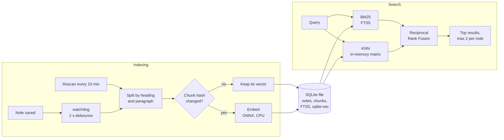

# Architecture

How vaultsearch indexes a vault and answers a query, and why it's built this way. For measurements, see [performance.md](performance.md).

## Overview

Three front ends share one engine:

- the Textual TUI (`vaultsearch`)
- the Rich CLI commands
- the MCP server (`vaultsearch serve`)

The engine (`src/vaultsearch/core/`) has no UI code.

## Indexing

- **Chunks.** Notes are split by heading and paragraph, up to ~1,200 characters per chunk. Each chunk keeps the heading it sits under.
- **Incremental.** Every chunk is hashed, so editing one paragraph re-embeds only that paragraph. Renaming or moving a note re-embeds nothing: its chunks follow it through `ON UPDATE CASCADE`.
- **Batched full builds.** `sync_all` works in two steps:
  - `_prepare` parses and diffs each note.
  - `_flush` gathers new chunks across many notes, sorts them by length and embeds them in one call. Each ONNX batch is padded to its longest text, so sorting keeps the padding low. It then writes them with `Store.write_notes`, one transaction per batch.
- **Watching.** watchdog events are debounced for 2 s. Cloud-synced folders (iCloud, OneDrive) don't always fire events, so the watcher also does a full rescan every 10 minutes. The rescan only compares modification times, so it costs almost nothing.
- **Storage.** A single SQLite file holds the notes, the chunks, an FTS5 keyword index (`unicode61`, diacritics removed) and the sqlite-vec vectors (cosine). It lives outside the vault, in `~/.vaultsearch/`. A database inside an iCloud or OneDrive folder would get synced mid-write and eventually corrupted.
- **Schema changes.** Changing the embedding model or bumping `SCHEMA_VERSION` rebuilds the index from scratch.

## Search

A query runs two searches and merges their rankings.

**BM25 keyword search** (`Store.fts_search`):

- Every word becomes a quoted prefix match, ORed with the others. The prefix stands in for stemming: "árbol" finds "árboles".
- Words found in more than 20% of the chunks are left out ("de", "the"...). Their IDF is close to 0, so they barely move the ranking, but FTS5 would still have to score every row they match. The list comes from the index itself, through a `fts5vocab` TEMP table, so it works in any language without a stopword list.

**KNN over the embeddings** (`core/vectors.py`):

- Every embedding is held in one normalised float32 matrix, and a search is a single matrix-vector product. It's exact, and gives the same results as sqlite-vec, which stays the store of record.
- The matrix is loaded once when the engine opens. Every `Store` write then updates it in place: adds are O(1), and a removal moves the last row into the gap. If a transaction rolls back, the matrix is dropped and reloaded on the next search.
- An approximate index (IVF, HNSW) would only pay off at around 100k chunks.

**Fusion.** Reciprocal Rank Fusion (k = 60) merges the two rankings without any score tuning. At most 2 chunks per note are kept, so results stay varied.

Embeddings find notes by meaning ("how was I studying" finds "review routine") but are bad at names and exact terms. BM25 is the opposite, which is why both are used.

## Embeddings

- **Model.** `paraphrase-multilingual-MiniLM-L12-v2`: 384 dimensions, English, Spanish, Japanese and dozens more, runs on CPU with ONNX, needs no API key.
- **Loading.** fastembed downloads the model once, about 220 MB. After that, `OnnxEmbedder` runs it from fastembed's cache with onnxruntime and tokenizers, set up exactly as fastembed sets them up: truncation, padding, special tokens and mean pooling. The vectors are identical, and the model loads in half the time, because importing fastembed alone takes ~1.7 s. If the snapshot is missing or can't be loaded, fastembed is used instead.

## Startup

Startup is part of the speed budget:

- **The TUI draws first.** `core/engine.py` imports the heavy modules (sqlite-vec, numpy, onnxruntime, watchdog) inside `Engine.open`, which runs in a background thread.
- **The index opens before the model.** `Engine.open` opens an existing index before loading the model and sets `keywords_ready`, so keyword searches work right away. Once the model is loaded it sets `ready`, and the TUI re-runs the current query as a hybrid search.
- **The CLI and the MCP server** wait for `ready`.

## The TUI

- **Note reader.** It doesn't use Textual's Markdown widget, which took 250 ms to 4 s per note. `tui/reader.py` renders the note with Rich to lines in a thread, records where each heading starts, and caches the result. The app prefetches the ±5 results around the selection.
- **Links.** Links become click actions, and are also reachable with `f` hints; `backspace` goes back. `core/links.py` resolves them the way Obsidian does.
- **Images.** Images are clickable captions, because terminal cells are too coarse for thumbnails. `tui/images.py` shows an image at full resolution in a modal screen through `textual-image`: Sixel on Windows Terminal, the Kitty protocol in Ghostty. Without either protocol, the image opens in the system viewer.
- **Search as you type.** A search waits 80 ms after the last keystroke. Searches run in a worker thread, and stale results are dropped.

## The vault map

`vaultsearch map` writes a single HTML page (three.js) that draws the vault as a mountain-and-water landscape (山水).

- **Placement.** Each note is the mean of its chunk embeddings, projected with UMAP (cosine), or with PCA when `umap-learn` isn't installed. Related notes form mountains: the more notes a subject has, the higher it stands, and its peaks are the most-linked notes.
- **Layout cache.** Positions are cached in `{db}-layout.json`, keyed by `Store.embedding_fingerprint()`, and the TUI warms that cache in the background. A refit is seeded with the old layout and Procrustes-aligned to it, so notes keep their place.
- **Window.** The map opens in a pywebview (WebView2) window when the `window` extra is installed. Otherwise it opens in a Chromium app-mode window (Edge on Windows), and as a last resort in the browser.
- **Dates.** When a note was written comes from, in order: its frontmatter (`created`, `date`...), a `YYYY-MM-DD` in its title (daily notes), or the file's creation time.
